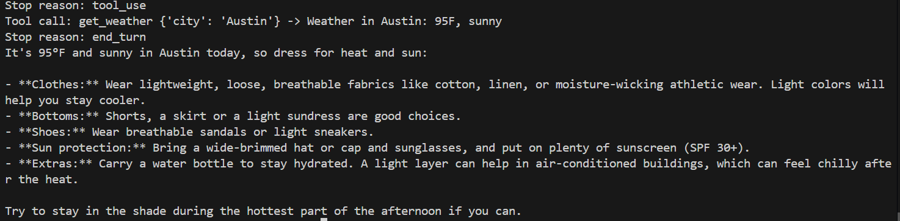
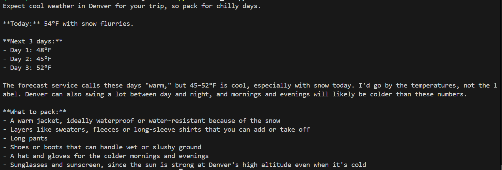
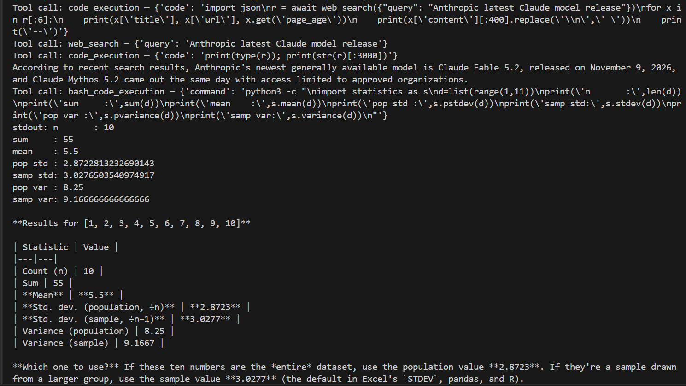
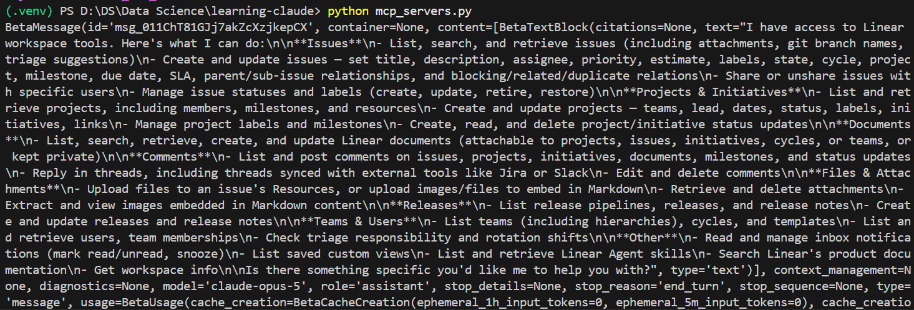

# learning-claude

Hands-on exercises from the **Claude Platform 101** course. One small, runnable script per concept, so I can re-run anything later and see how the pieces fit together.


---

## Progress

| # | Chapter | Script(s) | Status |
|---|---------|-----------|--------|
| 1 | First API call (Messages API) | `api_call.py` | ✅ Done |
| 2 | Tool use, manual agent loop | `agent.py` | ✅ Done |
| 3 | Tool use, `@beta_tool` + tool runner | `tool_use.py` | ✅ Done |
| 4 | Built-in server tools (web search, code execution) | `built_in_tools.py` | ✅ Done |
| 5 | **MCP (Model Context Protocol)** | `mcp_*.py` _(coming)_ | 🚧 In progress |

<!-- HOW TO UPDATE: when you finish a chapter, change 🚧 to ✅, and add a new row for the next chapter. -->

---

## Setup

**Requirements:** Python 3.10+ (developed on 3.14) and an Anthropic API key from the [Claude Console](https://console.anthropic.com/).

```bash
# 1. Clone the repo
git clone https://github.com/LeSopy/learning-claude.git
cd learning-claude

# 2. Create and activate a virtual environment
python -m venv .venv
.venv\Scripts\activate          # Windows
# source .venv/bin/activate     # macOS / Linux

# 3. Install dependencies
pip install -r requirements.txt

# 4. Add your API key
echo ANTHROPIC_API_KEY=your-key-here > .env.local
```

> ⚠️ `.env.local` and `.venv/` are in `.gitignore`. **Never commit your API key.**


---

## What's in here

### 1. `api_call.py`: First API call
Sends a single message to Claude and prints the reply.
- **Concepts:** `Anthropic()` client, `messages.create()`, `model`, `max_tokens`, reading `message.content[0].text`
- **Run:** `python api_call.py`


### 2. `agent.py`: Manual agent loop
Defines one tool (`get_weather`) with a JSON schema, then loops: send messages → if `stop_reason == "tool_use"`, run the tool and send the result back → stop on `end_turn`.
- **Concepts:** `tools` array (name, description, `input_schema`), `stop_reason`, `tool_use` / `tool_result` blocks, why the whole conversation is re-sent each turn
- **Run:** `python agent.py`




### 3. `tool_use.py`: `@beta_tool` + tool runner
Same idea as `agent.py`, but the SDK does the heavy lifting: decorate a function with `@beta_tool` and let `client.beta.messages.tool_runner()` run the loop. The manual version is kept as comments for comparison.
- **Concepts:** schema generated from type hints + docstring, multiple tools, `runner.until_done()`
- **Run:** `python tool_use.py`




### 4. `built_in_tools.py`: Server-side tools
Two calls where **Anthropic runs the tool for me**: web search and code execution (no `run_tool` function needed).
- **Concepts:** `server_tool_use` blocks, versioned tool types (`web_search_...`, `code_execution_...`), reading tool results from the response
- **Run:** `python built_in_tools.py`





### 5. `mcp_servers.py`: MCP (remote server)
Connects Claude to a third-party MCP server (Linear), so Claude can use that service's tools without me writing them. The provider owns and maintains the tools; I only choose which ones Claude can use.
- **Concepts:** `mcp_toolset`, host / client / server, tools vs. resources vs. prompts
- **Setup:** add `LINEAR_MCP_TOKEN=...` to `.env.local`
- **Run:** `python mcp_servers.py`




---

## Notes & gotchas

- Each script loads the key with `load_dotenv(".env.local")`, so run scripts **from the repo root**.
- Model names are hard-coded in each script; if one errors with "model not found", check the current list in the [docs](https://docs.claude.com).
- 
---

## Resources

- [Claude API docs](https://docs.claude.com)
- [Model Context Protocol](https://modelcontextprotocol.io)

---


